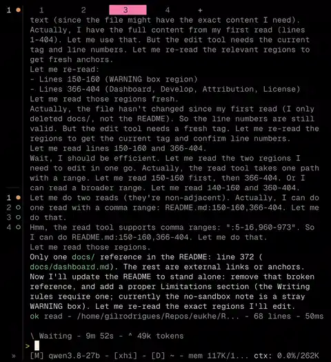

# Elpis

<a href="https://x.com/gildrb_/status/2115537230227759147"></a>

Elpis reads 1,221 tokens per second and writes 126 on one RTX 3090 at 350 W, with Qwen3.8-27B's full 262,144-token context ([bench/RESULTS.md](bench/RESULTS.md)). A speedup ships only if the text stays the same or passes a quality gate fixed before the measurement. Status: finished, with no further optimization planned.

## Install

Requires Linux, one RTX 3090, Docker with Compose, Buildx and the NVIDIA Container Toolkit (CDI `nvidia.com/gpu=0`), and Nix with flakes.

1. Make a private state directory with `models/`, `cache/`, `prefix-cache/` (mode 0700), `api-key` and `qwen-inference-launch.lock`, and download the pinned weights:

```sh
export QWEN_STATE_ROOT=/absolute/path/to/state
hf download r0b0tlab/Qwen3.8-27B-EXL3-4.00bpw --revision 3f1771b8c21f83cbb8e82169559ced9f38ca04e5 --local-dir "$QWEN_STATE_ROOT/models/qwen38-27b-exl3"
hf download r0b0tlab/Qwen3.8-27B-DFlash2-EXL3-4.00bpw --revision 265b5240592907d2d55ff0dc4d5f66569692604d --local-dir "$QWEN_STATE_ROOT/models/dflash2-exl3"
python3 -B prepare/verify-models.py --target "$QWEN_STATE_ROOT/models/qwen38-27b-exl3" --draft "$QWEN_STATE_ROOT/models/dflash2-exl3" --representation exl3
```

2. Build from source and start:

```sh
nix develop --no-write-lock-file -c true
bash docker/fetch-base.sh
bash docker/build-base.sh
bash docker/build-exl3.sh candidate-ext qwen-inference:exl3
export QWEN_IMAGE=qwen-inference:exl3
export QWEN_IMAGE_ID="$(docker image inspect -f '{{.Id}}' "$QWEN_IMAGE")"
export QWEN_ALLOW_UNQUALIFIED=1
docker compose --project-name qwen-inference up --no-build --pull never --detach --wait
```

## Use

```sh
curl http://127.0.0.1:18020/v1/chat/completions \
  -H "Authorization: Bearer $(cat "$QWEN_STATE_ROOT/api-key")" \
  -H "Content-Type: application/json" \
  -d '{"model": "qwen3.8-27b", "messages": [{"role": "user", "content": "Hello"}]}'
```

Any OpenAI client works with base URL `http://127.0.0.1:18020/v1`, model `qwen3.8-27b` and the key in `$QWEN_STATE_ROOT/api-key`. Tool calls are supported.

## Speed under a quality gate

- A change that alters the text ships only if it passes a gate set before the measurement: logits and 512-token continuations at 8K, 32K and 128K, against two exact-numerics floors, with pre-set limits.
- int8 attention in prefill and in decode verification changes the text and passes the gate. int8 MLP layers failed it and were dropped. Every kept and dropped attempt: [bench/RESULTS.md](bench/RESULTS.md).
- [elpis-lossless](https://github.com/gildrb/elpis-lossless) is the build with every changed op proven no less accurate than stock.

## A draft that never changes the output

- The DFlash2 draft proposes 7 tokens in one pass. Qwen3.8-27B checks them in one round, as an 8-row token tree, and keeps only the tokens it would have written itself.
- A Bend proof covers every prompt and every draft. On the GPU, 90 of 90 prompts were bit-identical with a normal, a capped and an always-rejected draft.

## Decision logic proven in Bend

- The acceptance logic, the kernel schedules and the tree-verify pipe are Bend programs with machine-checked proofs.
- The proven acceptor compiles to C, and the build checks it against a table.
- `nix run .#bend -- PROOF.bend` checks every proof.

## Components

- `serve/`: the OpenAI-compatible server and the serving recipe.
- `patches/`: 54 patches to ExLlamaV3's kernels.
- `LAWS.bend`, `PROOF.bend`, `bend/`: the claims and their proofs.
- `docker/`, `nix/`: the pinned build and the service ([nix/STANDALONE.md](nix/STANDALONE.md)).
- `bench/`, `eval/`: speed and quality measurements ([eval/README.md](eval/README.md)).

## Limitations

```
- Greedy only. One sequence at a time, one GPU prefix cache for all clients.
- Built and measured on one RTX 3090 (SM86) only.
- Evicted prefix pages wait in an 8 GiB host-RAM tier. While the tier is on, the prefix
  cache does not survive restarts.
- With stream=true, tool calls arrive at the end of the turn.
- Attention computes Q·Kᵀ in int8, so outputs can differ from fp16. Prefill attention
  error against fp64 is 3.6 to 33 times stock's.
- 4-bit weights and the 3-bit KV cache cost quality against BF16.
- Exact logit ties can depend on max_tokens. Compare outputs only at equal request
  parameters.
- The proofs cover Bend models of the kernels. Source links and GPU tests cover the link
  to CUDA. No proof covers numeric precision.
```

## Credits

- [Qwen3.8-27B](https://huggingface.co/Qwen/Qwen3.8-27B) by Qwen.
- 4-bit EXL3 weights, the DFlash2 draft and the container recipe by [r0b0tlab](https://github.com/r0b0tlab/qwen38-exl3-dflash2) ([@mr_r0b0t](https://x.com/mr_r0b0t)), after [incoai/Qwen3.8-27B-DFlash2](https://huggingface.co/incoai/Qwen3.8-27B-DFlash2).
- [ExLlamaV3](https://github.com/turboderp-org/exllamav3) by Turboderp, from r0b0tlab's community branch.
- [Bend](https://github.com/bendlang/bend).
- Third-party notices: [THIRD-PARTY.md](THIRD-PARTY.md).

## License

MIT. See [LICENSE](LICENSE). Security reports: [SECURITY.md](SECURITY.md).
